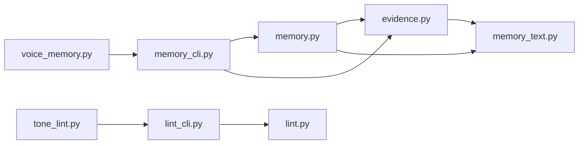
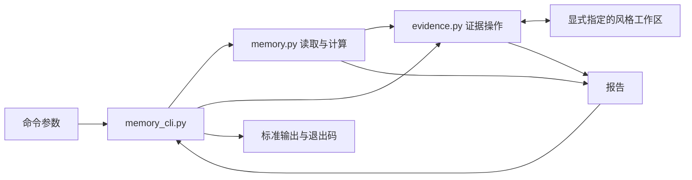

# 架构

Voiceforge 是供 Agent 起草和修改文字的 Skill。宿主 Agent 理解事实和语义，Python 工具检查已知表达并管理可选的个人风格证据。普通写作只需要通用规则和检查工具。

已有风格工作区时，下面的调用返回已确认个人样本、偏好和负面证据：

```bash
python3 scripts/voice_memory.py context --workspace ./style-workspace
```

默认响应保留 `human_reference` 字段，其值为 `[]`。第三方参考摘录和方法卡片只在显式维护研究中返回：

```bash
python3 scripts/voice_memory.py context --workspace ./style-workspace \
	--research --intended-use private
```

研究结果仍需通过来源许可和用途筛选。`prepare` 将任务事实放入 `fact_evidence`，将普通草稿上下文放入 `style_context`。它接受旧版 `--human-limit` 参数，但该参数不会开启研究访问。

## 模块按知识分工

原先的 `voice_memory.py` 同时处理持久化、检索、统计和命令行。现在，执行入口保留原路径，内部函数按所拥有的规则分组。下面的模块都位于 `scripts/_voiceforge/`。

| 模块 | 所拥有的行为 |
| --- | --- |
| `memory_cli.py` | 解析参数、区分草稿与研究请求、输出报告和退出码 |
| `memory.py` | 计算画像、成熟度、候选建议、检索排名和任务上下文 |
| `evidence.py` | 管理工作区路径、格式、来源、确认、隐私、日志和全部写入 |
| `memory_text.py` | 提取来源正文，计算文本特征、修改差异和编辑比例 |
| `lint_cli.py` | 读取文件或标准输入，输出文本或 JSON 诊断 |
| `lint.py` | 从可见正文匹配统一规则目录，返回带稳定 ID 的诊断 |

箭头表示模块依赖。检索和证据代码都可以直接使用文本统计函数，通用检查独立于风格工作区。



读取操作由 `memory.py` 计算报告，写入操作由 `evidence.py` 完整处理。进程层只负责参数适配和输出，既不拼接注册表与日志的写入步骤，也不保存派生状态。



目录分组没有增加服务、数据库或第三方 Python 依赖。分发单位仍是完整 Skill 目录，两个执行入口依赖随附的 `scripts/_voiceforge/`。只复制入口脚本无法运行，也不需要另一个已安装的 Skill。

## 草稿和研究使用不同请求

`DraftQuery` 是不可变的草稿请求，保存语言、体裁、受众、查询词和个人证据数量。`intended_use` 在这里仅记录任务用途，不授予研究访问权限。这个类型没有研究开关或第三方参考数量。

`ResearchQuery` 包含一个 `DraftQuery` 和研究结果数量。只有 `context --research` 创建这个请求，再调用 `research_context()`。`draft_context()` 固定返回空的第三方参考列表，相关检索统计为零。默认结果也不附带方法卡片内容。

`prepare()` 只接受 `DraftQuery`，并调用 `draft_context()`。这项限制修正了原先文档与代码的差异：旧代码会把研究摘录放进生成上下文，现在事实材料、个人表达证据和第三方研究各有明确用途。`prepare --research` 会作为无效参数被拒绝。

候选个人样本和留出样本始终排除在生成检索之外。用户确认的个人样本只影响表达，不能替代任务事实。工作区格式和角色定义见[语料索引格式](corpus-schema.md)。

## 证据拥有确认与写入规则

`evidence.py` 是工作区写入的唯一模块。初始化、反馈、样本确认、第三方来源确认、偏好追加和评估记录都由各自的完整操作处理。预览与正式写入使用相同的记录构造和校验规则，正式写入还检查对应确认参数。

注册表保存样本身份和状态，`Voice Profile.md` 保存偏好，方法索引保存第三方参考的方法记录。反馈和评估日志保存历史证据。偏好的替代关系保留旧记录，便于追溯，具体规则见[长期写作偏好](preference-memory.md)。

读取命令保留各自的校验范围。`validate` 汇总注册表、方法、偏好和评估问题；`profile` 只执行其原有校验。抽取模块没有引入一个在每次调用时读取全部日志的总加载器。

画像、排名和成熟度从证据重新计算。`healthy` 表示数据格式有效，`readiness.activation.ready` 表示全部成熟度条件满足。评估读取会核对引用文件的哈希并重算结果，不能靠修改记录中的通过标志开启成熟状态。完整条件见[评估](evaluation.md)。

## 函数模块的取舍

设计比较了函数模块与 `Workspace` 聚合对象两种方案。当前采用函数模块。每条 CLI 命令启动一个新进程，显式传入工作区和请求，已有函数可以直接迁移。聚合对象需要同时容纳证据操作、检索和派生报告，增加了对象生命周期及缓存是否过期的问题，却没有减少本工具的调用步骤。

这次拆分保留了内部字典和原有记录格式，只为新的草稿与研究边界增加不可变请求类型。代价是部分内部函数仍接收命令参数对象；收益是存储格式和报告字段不必同时改写。内部包不提供旧辅助函数的兼容导出。

`evidence.py` 仍是较大的模块。这是首次迁移的明确取舍：来源、确认、校验和写入共同保护同一份持久化记录，放在一起比拆成加载、校验和保存阶段更容易核对。只有独立记录类别的修改开始互相干扰时，才值得按偏好、反馈或评估等所有权继续拆分。

## 保留统计行为与检验依据

通用检查和风格统计保留各自的 Markdown 处理规则。`lint()` 排除代码、链接目标、元数据和隐藏 HTML，保留原始行号。`memory_text.clean_markdown()` 沿用原有来源正文和行内代码的统计方式。直接合并两者会改变画像数值，也可能使历史评估重算产生不同结果。

通用检查通过一次 `lint(text)` 返回诊断，文本和 JSON 输出共用这些结果。原有阻断规则继续产生 `FAIL`，新增的语境相关检查产生 `WARN`。事实准确性、真实范围、术语一致性和含义完整性仍由宿主 Agent 复核，规则匹配不能代替这些判断。检测规则与输出约定见[通用检测参考](lint-reference.md)。

成熟度阈值和第三方参考覆盖要求保持原值。仓库历史没有说明这些数值的校准依据，也没有解释第三方研究库为何参与个人成熟度判断。后续调整需要单独的留出评估，检验事实错误、约束错误和实际修改负担，不能从模块拆分推导出规则有效性。
